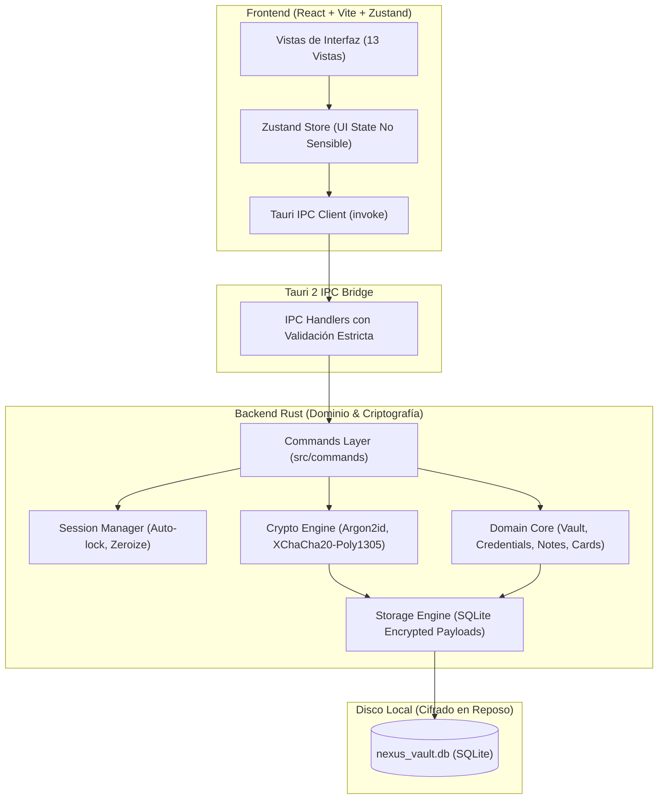
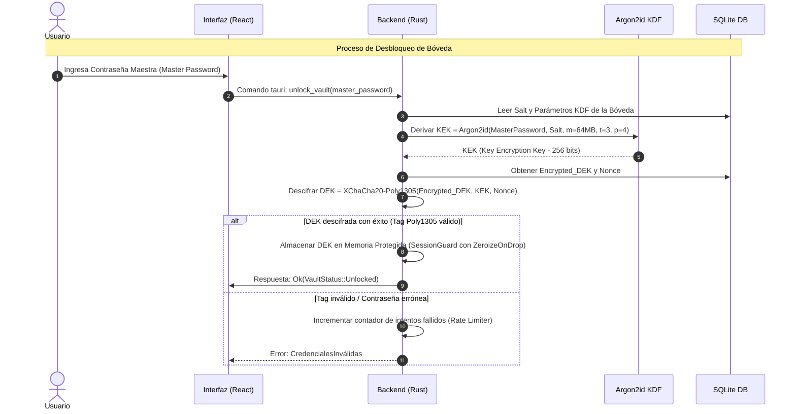

# ARQUITECTURA DE NEXUS VAULT 🏛️

## 1. Visión General del Sistema

NEXUS VAULT está estructurado siguiendo los principios de arquitectura limpia (*Clean Architecture*) y separación estricta de responsabilidades (*Separation of Concerns*). El sistema se divide en dos mundos claramente delimitados:

1. **Frontend (Capa de Presentación & UI no confiable)**:
   - Desarrollado en React 18 con TypeScript y empaquetado mediante Vite.
   - Responsable de la renderización visual, interacción con el usuario, accesibilidad, temas y enrutamiento interno.
   - **Regla de oro de seguridad**: El frontend *nunca* procesa criptografía pesada, no deriva claves, no almacena la contraseña maestra en memoria global, y trata todos los datos de sesión como efímeros.

2. **Backend (Capa de Confianza & Núcleo Criptográfico en Rust)**:
   - Se ejecuta en el proceso del host nativo gestionado por Tauri 2.
   - Encapsula toda la lógica criptográfica sensible (Argon2id, XChaCha20-Poly1305, CSPRNG).
   - Administra el almacenamiento persistente mediante SQLite con registros cifrados.
   - Implementa control de ciclo de vida de la sesión (bloqueo por inactividad, limpieza de búferes con `Zeroize`).



---

## 2. Jerarquía Criptográfica y Ciclo de Vida de Claves

NEXUS VAULT implementa un esquema de **clave sobre clave (Envelope Encryption)** que garantiza que nunca se deba re-cifrar toda la base de datos para una operación de cambio de contraseña:



### Definición de Claves:
1. **Contraseña Maestra (Master Password)**:
   - Conocida únicamente por el usuario.
   - Nunca se persiste en disco, ni en logs, ni en archivos de configuración.
   - En el backend se recibe en un búfer que se sobreescribe con ceros (`Zeroize`) inmediatamente tras la derivación de la KEK.
2. **KEK (Key Encryption Key)**:
   - Clave de 256 bits generada al vuelo mediante **Argon2id**.
   - Parámetros por defecto:
     - Memoria: 65,536 KiB (64 MiB)
     - Iteraciones (tiempo): 3
     - Paralelismo: 4 hilos
     - Longitud de salida: 32 bytes
3. **DEK (Data Encryption Key)**:
   - Clave simétrica de 256 bits generada mediante CSPRNG del sistema operativo (`rand_core::OsRng`).
   - Se almacena en la tabla de metadatos de la base de datos, cifrada con la KEK mediante **XChaCha20-Poly1305**.
   - Se mantiene en memoria RAM únicamente mientras la bóveda permanezca desbloqueada.
   - En el momento del bloqueo (manual o por inactividad), la estructura en memoria se destruye invocando `zeroize()`.

---

## 3. Formato del Payload Cifrado y Datos Autenticados Adicionales (AAD)

Cada ítem almacenado (contraseña, nota, tarjeta, información personal) o sobre de clave se serializa en un objeto binario autenticado de forma estricta (especificación normativa en `CRYPTO_FORMAT_SPEC.md`):

```text
+-----------------------+-----------------------+----------------------------------+
| Version (1 byte)      | Nonce (24 bytes)      | Ciphertext + Poly1305 Tag (16B)  |
| 0x01                  | CSPRNG XNonce (192b)  | Payload cifrado autenticado      |
+-----------------------+-----------------------+----------------------------------+
```

### 3.1. Autenticación de Contexto e Identidad (AAD Obligatorio)
Para neutralizar ataques de **sustitución de ciphertext (*ciphertext swapping*)** entre filas de la base de datos o confusión de tipos:
```text
AAD = Version (0x01) || DomainSeparator (1B) || ContextLen (2B BE) || ContextID (NB)
```
- **Separadores de Dominio**:
  - `0x01` (`DekEnvelope`): Cifrado de DEK con KEK (ContextID: `b"ROOT_DEK"`).
  - `0x02` (`VaultItem`): Cifrado de registro individual (ContextID: UUID v4 del ítem).
  - `0x03` (`Folder`): Cifrado de metadatos de carpeta (ContextID: UUID v4 de la carpeta).
  - `0x04` (`BackupExport`): Cifrado de archivo de exportación de respaldo.

### 3.2. Evaluación Rigurosa de Probabilidad de Colisión de Nonces (192 bits)
Bajo la aproximación del problema del cumpleaños, para un espacio de $n = 192$ bits y $q$ generaciones:
$$P \approx \frac{q^2}{2^{n+1}} = \frac{q^2}{2^{193}}$$
- Para $q = 2^{32} \approx 4.29 \times 10^9$ registros cifrados: $P \approx 2^{-129} \approx 1.47 \times 10^{-39}$.
- Para $q = 2^{64}$ operaciones: $P \approx 2^{-65} \approx 2.71 \times 10^{-20}$.
- El punto de colisión del 50% se sitúa en $q \approx 2^{96}$ operaciones ($\sqrt{2^{192}}$), por lo que para el ciclo de vida de una bóveda local ($q < 10^5$), la probabilidad de colisión es estrictamente nula en la práctica, superando ampliamente a esquemas con nonces de 96 bits como AES-GCM.

---

## 4. Esquema de Persistencia SQLite y Mitigación de Fuga de Metadatos

La base de datos SQLite se almacena en el directorio protegido de la aplicación con permisos restringidos de sistema operativo:
- **Windows**: `%LOCALAPPDATA%\NexusVault\vault.db` (Protegido vía ACLs `icacls` exclusivamente para el SID del usuario actual).
- **Linux**: `~/.local/share/nexusvault/vault.db` (Permisos `chmod 0600`).

### 4.1. Reducción Estricta de Exposición de Metadatos:
A diferencia de esquemas convencionales que dejan carpetas, favoritos o estados de papelera en columnas legibles, NEXUS VAULT almacena todos los atributos taxonómicos **dentro del payload cifrado con la DEK**. Un adversario que examine `vault.db` solo observa UUIDs opacos y marcas de tiempo, sin poder deducir qué elementos son notas, contraseñas o tarjetas.

### 4.2. Tablas de Persistencia:

1. `vault_metadata`:
   - `id` (INTEGER PRIMARY KEY)
   - `format_version` (INTEGER - 0x01)
   - `kdf_salt` (BLOB, 32 bytes CSPRNG)
   - `kdf_memory_kib` (INTEGER - Validado entre 16 MiB y 1 GiB)
   - `kdf_iterations` (INTEGER - Validado entre 1 y 64)
   - `kdf_parallelism` (INTEGER - Validado entre 1 y 16)
   - `encrypted_dek` (BLOB - Sobre cifrado con KEK y AAD `DekEnvelope`)
   - `created_at` (TEXT ISO8601)
   - `updated_at` (TEXT ISO8601)

2. `vault_items`:
   - `id` (TEXT UUID v4 PRIMARY KEY)
   - `encrypted_data` (BLOB - Payload versionado 0x01 cifrado con DEK y AAD `VaultItem || id`)
   - `created_at` (TEXT ISO8601)
   - `updated_at` (TEXT ISO8601)

3. `folders`:
   - `id` (TEXT UUID v4 PRIMARY KEY)
   - `encrypted_data` (BLOB - Nombre de carpeta cifrado con DEK y AAD `Folder || id`)
   - `created_at` (TEXT ISO8601)

### 4.3. Modo WAL, Archivos Auxiliares y Respaldos Consistentes:
- **Modo WAL (Write-Ahead Logging)**: Configurado obligatoriamente (`PRAGMA journal_mode = WAL; PRAGMA synchronous = NORMAL;`).
- **Manejo de `-wal` y `-shm`**: El borrado o respaldo de la bóveda considera atómicamente estos archivos.
- **Respaldos Consistentes**: Para prevenir corrupción al respaldar bases de datos abiertas, los respaldos se generan mediante la API de copia en línea (`VACUUM INTO 'ruta/backup.db'`), congelando una instantánea transaccional consistente sin bloquear lectores.

### 4.4. Protocolo Transaccional para Cambio de Contraseña Maestra:
1. Validar la contraseña actual descifrando la DEK en memoria RAM.
2. Derivar `new_kek` con nueva sal aleatoria de 32 bytes y nueva contraseña maestra.
3. Cifrar la DEK existente bajo `new_kek` con nuevo nonce y AAD.
4. Abrir transacción exclusiva SQLite (`BEGIN EXCLUSIVE TRANSACTION;`).
5. Actualizar `vault_metadata` de forma atómica.
6. Ejecutar `COMMIT;`. Ante cualquier fallo o corte de energía antes del commit, SQLite revierte la operación y la contraseña anterior permanece válida.
7. Aplicar `zeroize()` sobre contraseñas y KEKs.

---

## 5. Módulos del Sistema

| Módulo | Ruta | Responsabilidad |
| :--- | :--- | :--- |
| **Crypto Core** | `src-tauri/src/crypto/` | Argon2id KDF, XChaCha20-Poly1305 AEAD, generación CSPRNG, abstracciones `Zeroizing<T>`. |
| **Vault Manager** | `src-tauri/src/vault/` | Ciclo de vida de la bóveda: creación, desbloqueo, bloqueo, rotación de KEK (cambio de master password). |
| **Storage Engine** | `src-tauri/src/storage/` | Conexión SQLite, migraciones versionadas, sentencias preparadas, transacciones atómicas. |
| **Domain Services** | `src-tauri/src/domain/` | Validación de entradas, modelos de credenciales, notas, tarjetas, carpetas y auditoría de contraseñas. |
| **Session & Clipboard** | `src-tauri/src/session/` | Temporizador de inactividad, monitoreo de eventos de sistema (bloqueo/suspensión) y limpieza segura de portapapeles. |
| **Tauri Commands** | `src-tauri/src/commands/` | Controladores IPC que exponen métodos tipados a la interfaz de usuario con validación estricta. |
| **Frontend UI** | `src/` | Aplicación React 18, temas Tailwind, componentes de interfaz y estado en Zustand. |
