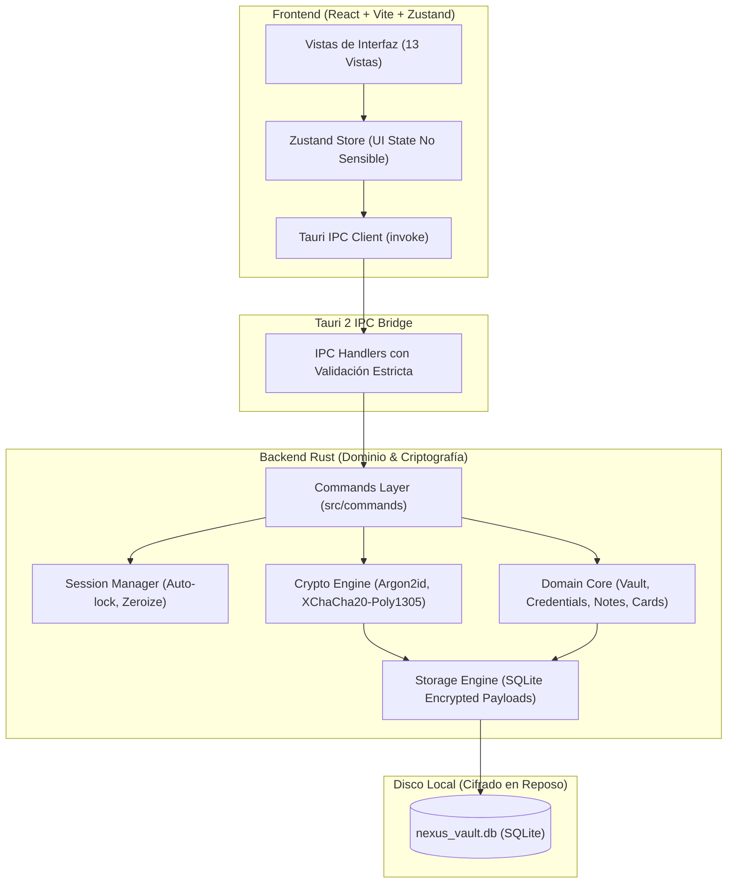
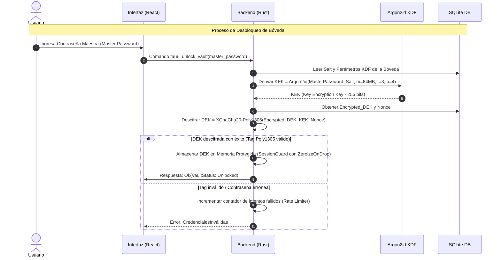

# ARQUITECTURA DE NEXUS VAULT 🏛️

## 1. Visión General del Sistema

NEXUS VAULT está estructurado siguiendo los principios de arquitectura limpia (*Clean Architecture*) y separación estricta de responsabilidades (*Separation of Concerns*). El sistema se divide en dos mundos claramente delimitados:

1. **Frontend (Capa de Presentación & UI no confiable)**:
   - Desarrollado en React 18 con TypeScript y empaquetado mediante Vite.
   - Responsable de la renderización visual, interacción con el usuario, accesibilidad, temas y enrutamiento interno.
   - **Regla de oro de seguridad**: El frontend *nunca* procesa criptografía pesada, no deriva claves, no almacena la contraseña maestra en memoria global, y trata todos los datos de sesión como efímeros.

2. **Backend (Capa de Confianza & Núcleo Criptográfico en Rust)**:
   - Se ejecuta en el proceso del host nativo gestionado por Tauri 2.
   - Encapsula toda la lógica criptográfica sensible (Argon2id, XChaCha20-Poly1305, CSPRNG).
   - Administra el almacenamiento persistente mediante SQLite con registros cifrados.
   - Implementa control de ciclo de vida de la sesión (bloqueo por inactividad, limpieza de búferes con `Zeroize`).



---

## 2. Jerarquía Criptográfica y Ciclo de Vida de Claves

NEXUS VAULT implementa un esquema de **clave sobre clave (Envelope Encryption)** que garantiza que nunca se deba re-cifrar toda la base de datos para una operación de cambio de contraseña:



### Definición de Claves:
1. **Contraseña Maestra (Master Password)**:
   - Conocida únicamente por el usuario.
   - Nunca se persiste en disco, ni en logs, ni en archivos de configuración.
   - En el backend se recibe en un búfer que se sobreescribe con ceros (`Zeroize`) inmediatamente tras la derivación de la KEK.
2. **KEK (Key Encryption Key)**:
   - Clave de 256 bits generada al vuelo mediante **Argon2id**.
   - Parámetros por defecto:
     - Memoria: 65,536 KiB (64 MiB)
     - Iteraciones (tiempo): 3
     - Paralelismo: 4 hilos
     - Longitud de salida: 32 bytes
3. **DEK (Data Encryption Key)**:
   - Clave simétrica de 256 bits generada mediante CSPRNG del sistema operativo (`rand_core::OsRng`).
   - Se almacena en la tabla de metadatos de la base de datos, cifrada con la KEK mediante **XChaCha20-Poly1305**.
   - Se mantiene en memoria RAM únicamente mientras la bóveda permanezca desbloqueada.
   - En el momento del bloqueo (manual o por inactividad), la estructura en memoria se destruye invocando `zeroize()`.

---

## 3. Formato del Payload Cifrado (Versionado)

Cada ítem almacenado (contraseña, nota, tarjeta, información personal) se serializa a nivel de campo en un objeto binario con autenticación asociada:

```text
+-----------------------+-----------------------+----------------------------------+
| Version (1 byte)      | Nonce (24 bytes)      | Ciphertext + Poly1305 Tag (16B)  |
| 0x01                  | CSPRNG XChaCha Nonce  | Payload JSON serializado cifrado |
+-----------------------+-----------------------+----------------------------------+
```

### Ventajas de este Formato:
- **Resistencia a Colisiones**: Con un nonce de 192 bits (24 bytes), se pueden generar $2^{96}$ nonces aleatorios con probabilidad de colisión prácticamente nula, eliminando la necesidad de contadores sincronizados en disco.
- **Autenticación Fuerte**: Poly1305 rechaza cualquier modificación o corrupción de un solo bit antes de que el texto plano sea expuesto a la capa de deserialización.
- **Evolución y Migración**: El prefijo de versión (`0x01`) permite que futuras versiones del software introduzcan algoritmos post-cuánticos o esquemas alternativos sin romper la compatibilidad con bóvedas existentes.

---

## 4. Esquema de Persistencia SQLite

La base de datos SQLite se crea en la ruta de datos protegida de la aplicación:
- **Windows**: `%LOCALAPPDATA%\NexusVault\vault.db`
- **Linux**: `~/.local/share/nexusvault/vault.db`

### Tablas Principales:

1. `vault_metadata`:
   - `id` (INTEGER PRIMARY KEY)
   - `format_version` (INTEGER)
   - `kdf_salt` (BLOB, 32 bytes)
   - `kdf_memory_kib` (INTEGER)
   - `kdf_iterations` (INTEGER)
   - `kdf_parallelism` (INTEGER)
   - `encrypted_dek` (BLOB)
   - `dek_nonce` (BLOB, 24 bytes)
   - `created_at` (TEXT ISO8601)
   - `updated_at` (TEXT ISO8601)

2. `vault_items`:
   - `id` (TEXT UUID PRIMARY KEY)
   - `item_type` (TEXT - 'login', 'note', 'card', 'identity')
   - `folder_id` (TEXT UUID nullable)
   - `is_favorite` (BOOLEAN)
   - `is_trashed` (BOOLEAN)
   - `encrypted_data` (BLOB - Payload cifrado con DEK)
   - `created_at` (TEXT ISO8601)
   - `updated_at` (TEXT ISO8601)

3. `folders`:
   - `id` (TEXT UUID PRIMARY KEY)
   - `encrypted_name` (BLOB - Nombre de la carpeta cifrado con DEK)
   - `created_at` (TEXT ISO8601)

> **Nota Crítica**: Los nombres de las carpetas, títulos de servicios y metadatos de usuario están completamente cifrados dentro del payload. La base de datos en reposo únicamente expone UUIDs opacos y tipos genéricos de ítem para indexación rápida.

---

## 5. Módulos del Sistema

| Módulo | Ruta | Responsabilidad |
| :--- | :--- | :--- |
| **Crypto Core** | `src-tauri/src/crypto/` | Argon2id KDF, XChaCha20-Poly1305 AEAD, generación CSPRNG, abstracciones `Zeroizing<T>`. |
| **Vault Manager** | `src-tauri/src/vault/` | Ciclo de vida de la bóveda: creación, desbloqueo, bloqueo, rotación de KEK (cambio de master password). |
| **Storage Engine** | `src-tauri/src/storage/` | Conexión SQLite, migraciones versionadas, sentencias preparadas, transacciones atómicas. |
| **Domain Services** | `src-tauri/src/domain/` | Validación de entradas, modelos de credenciales, notas, tarjetas, carpetas y auditoría de contraseñas. |
| **Session & Clipboard** | `src-tauri/src/session/` | Temporizador de inactividad, monitoreo de eventos de sistema (bloqueo/suspensión) y limpieza segura de portapapeles. |
| **Tauri Commands** | `src-tauri/src/commands/` | Controladores IPC que exponen métodos tipados a la interfaz de usuario con validación estricta. |
| **Frontend UI** | `src/` | Aplicación React 18, temas Tailwind, componentes de interfaz y estado en Zustand. |
