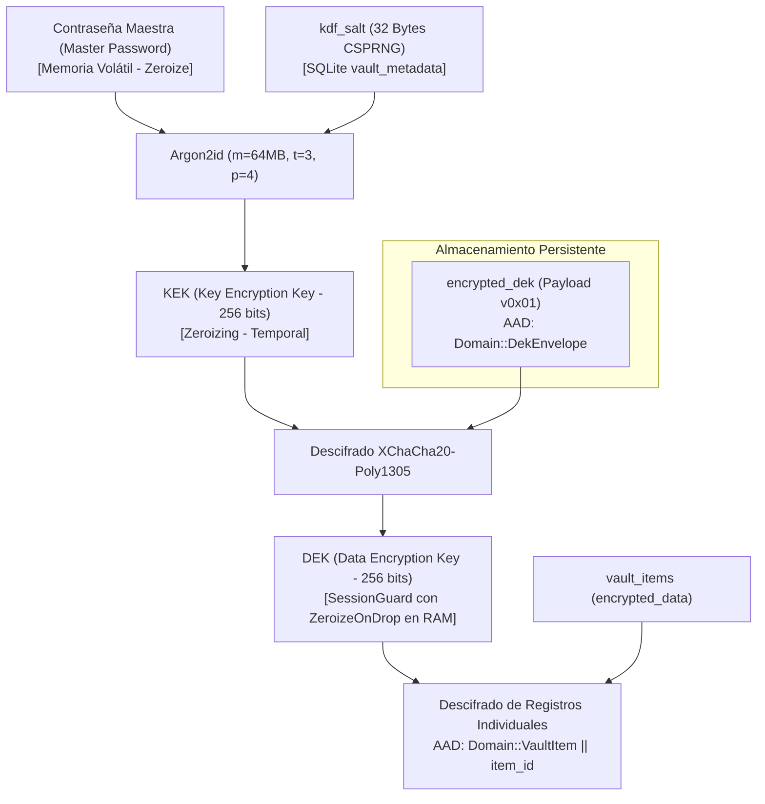

# ESPECIFICACIÓN DEL FORMATO CRIPTOGRÁFICO Y GESTIÓN DE CLAVES 📜
> **NEXUS VAULT — Versión de Formato 0x01**
> *Documento Normativo de Arquitectura Criptográfica*

---

## 1. Visión General del Formato

NEXUS VAULT utiliza una arquitectura de cifrado de sobre (*Envelope Encryption*) de dos niveles combinada con **Cifrado Autenticado con Datos Asociados (AEAD)** mediante **XChaCha20-Poly1305** y derivación de clave con **Argon2id**.

Toda estructura cifrada persistida en disco (base de datos SQLite, archivos `.nexusbackup`) o transmitida a través de límites de confianza debe cumplir de manera estricta con esta especificación binaria.

---

## 2. Estructura Binaria del Payload Cifrado (Versión 0x01)

Cualquier registro individual, metadato confidencial o sobre de clave se empaqueta bajo el siguiente diseño binario contiguo:

```text
 0                   1                   2                   3
 0 1 2 3 4 5 6 7 8 9 0 1 2 3 4 5 6 7 8 9 0 1 2 3 4 5 6 7 8 9 0 1
+-+-+-+-+-+-+-+-+-+-+-+-+-+-+-+-+-+-+-+-+-+-+-+-+-+-+-+-+-+-+-+-+
| Version (0x01)|                                               |
+-+-+-+-+-+-+-+-+        XNonce (Bytes 0..19)                   |
|                                                               |
|                               +-+-+-+-+-+-+-+-+-+-+-+-+-+-+-+-+
|                               |     XNonce (Bytes 20..23)     |
+-+-+-+-+-+-+-+-+-+-+-+-+-+-+-+-+-+-+-+-+-+-+-+-+-+-+-+-+-+-+-+-+
|                                                               |
|                  Ciphertext (Variable Length)                 |
|                                                               |
+-+-+-+-+-+-+-+-+-+-+-+-+-+-+-+-+-+-+-+-+-+-+-+-+-+-+-+-+-+-+-+-+
|                                                               |
|                     Poly1305 Tag (16 Bytes)                   |
|                                                               |
+-+-+-+-+-+-+-+-+-+-+-+-+-+-+-+-+-+-+-+-+-+-+-+-+-+-+-+-+-+-+-+-+
```

### Campos:
1. **`Version` (1 byte, offset 0)**:
   - Valor obligatorio: `0x01`.
   - Cualquier valor diferente debe ser rechazado inmediatamente con `CryptoError::UnsupportedVersion` antes de realizar operaciones criptográficas o asignación de memoria.
2. **`XNonce` (24 bytes, offsets 1..24)**:
   - Nonce extendido de 192 bits generado mediante CSPRNG del sistema operativo (`rand_core::OsRng`).
   - Generación determinista prohibida. Nunca se reutiliza un nonce con la misma clave.
3. **`Ciphertext` (longitud variable, offsets 25..N-16)**:
   - Texto cifrado mediante el flujo simétrico XChaCha20.
   - Longitud máxima permitida: 4 MiB (`MAX_PAYLOAD_BYTES`).
4. **`Poly1305 Tag` (16 bytes, offsets N-15..N)**:
   - Código de autenticación de mensaje de un solo uso calculado sobre el texto cifrado y los Datos Asociados (AAD).

---

## 3. Especificación de Datos Autenticados Adicionales (AAD)

### 3.1. Problema de Seguridad: Ataques de Intercambio de Ciphertext (*Ciphertext Swapping*)
Si un sistema AEAD se limita a autenticar el contenido plano sin vincularlo al contexto, un adversario con acceso de modificación a la base de datos SQLite podría intercambiar los blobs cifrados entre dos registros (ejemplo: reemplazar el blob cifrado del ítem A por el del ítem B) o entre dominios (ejemplo: inyectar el blob de una nota en el campo de la DEK). El tag Poly1305 sería matemáticamente válido y el descifrado tendría éxito, corrompiendo la integridad contextual.

### 3.2. Estructura Normativa del AAD en NEXUS VAULT
Para eliminar de raíz esta vulnerabilidad, todo cifrado calcula el tag Poly1305 vinculando obligatoriamente los siguientes datos asociados:

```text
AAD = Version (1B) || DomainSeparator (1B) || ContextLen (2B BE) || ContextID (NB)
```

| Campo | Tipo | Descripción |
| :--- | :--- | :--- |
| `Version` | `u8` | Versión del formato (`0x01`). Previene ataques de degradación de versión. |
| `DomainSeparator` | `u8` | Separador de dominio criptográfico que aísla los propósitos de clave. |
| `ContextLen` | `u16 (Big-Endian)` | Longitud en bytes del identificador de contexto. |
| `ContextID` | `[u8]` | Identificador unívoco del elemento (UUID v4 en bytes o literal reservado). |

### 3.3. Tabla de Separadores de Dominio (`DomainSeparator`):
| Separador | Byte | Propósito Criptográfico | `ContextID` Esperado | Clave Utilizada |
| :--- | :---: | :--- | :--- | :--- |
| `DekEnvelope` | `0x01` | Cifrado de la clave DEK dentro de `vault_metadata` | Literal UTF-8: `b"ROOT_DEK"` | KEK |
| `VaultItem` | `0x02` | Cifrado de registros de credenciales, tarjetas o identidades | UUID v4 canónico del ítem (`item.id`) | DEK |
| `Folder` | `0x03` | Cifrado de metadatos o nombre de carpeta | UUID v4 canónico de la carpeta (`folder.id`) | DEK |
| `BackupExport` | `0x04` | Cifrado de exportación/respaldo completo de bóveda | Hash SHA-256 del salt de exportación | Clave de Respaldo |

> **Garantía Criptográfica**: Si un atacante copia el payload cifrado del ítem `uuid-A` en la fila del ítem `uuid-B`, la verificación de Poly1305 fallará con `CryptoError::DecryptionFailed` porque el AAD derivado de `uuid-B` no coincidirá con el AAD autenticado durante el cifrado.

---

## 4. Análisis Riguroso de Probabilidad de Colisión de Nonces

### Corrección Matemática (Problema del Cumpleaños):
Con un espacio de nonce de $n = 192$ bits, la probabilidad $P$ de observar al menos una colisión al generar $q$ nonces aleatorios independientes bajo la misma clave viene modelada por la aproximación del cumpleaños:

$$P \approx 1 - \exp\left(-\frac{q^2}{2^{n+1}}\right) \approx \frac{q^2}{2^{n+1}} = \frac{q^2}{2^{193}}$$

### Evaluación Práctica:
1. **Escenario de Uso Masivo ($q = 2^{32} \approx 4.29 \times 10^9$ registros)**:
   $$P \approx \frac{(2^{32})^2}{2^{193}} = \frac{2^{64}}{2^{193}} = 2^{-129} \approx 1.47 \times 10^{-39}$$
2. **Escenario Extremo ($q = 2^{64} \approx 1.84 \times 10^{19}$ operaciones)**:
   $$P \approx \frac{(2^{64})^2}{2^{193}} = \frac{2^{128}}{2^{193}} = 2^{-65} \approx 2.71 \times 10^{-20}$$

*Aclaración frente a versiones preliminares*: El punto del 50% de probabilidad de colisión se alcanzaría a $q \approx 2^{96}$ nonces ($\sqrt{2^{192}}$), no a $2^{96}$ con probabilidad nula. Dado que una bóveda de contraseñas de escritorio maneja típicamente $q < 10^5$ registros a lo largo de su vida útil, la probabilidad de colisión con 192 bits es estrictamente despreciable e infinitamente inferior al límite crítico de 96 bits de AES-GCM (donde el límite seguro de NIST es $2^{32}$ cifrados).

---

## 5. Jerarquía de Claves KEK / DEK



---

## 6. Validación de Parámetros KDF y Límites de Entrada (Defensa DoS)

Antes de invocar rutinas criptográficas o reservar memoria para descifrado, el backend valida rigurosamente los siguientes límites:

| Parámetro | Límite Inferior | Límite Superior | Valor por Defecto | Justificación |
| :--- | :---: | :---: | :---: | :--- |
| `memory_kib` | 16,384 (16 MiB) | 1,048,576 (1 GiB) | 65,536 (64 MiB) | Evita asignaciones masivas de RAM (OOM DoS) por bases de datos manipuladas. |
| `iterations` | 1 | 64 | 3 | Previene bloqueos de CPU por bucles infinitos calculados deliberadamente. |
| `parallelism` | 1 | 16 | 4 | Evita saturación de hilos del sistema operativo (*thread exhaustion*). |
| `salt_size` | 32 bytes | 32 bytes | 32 bytes | Longitud fija obligatoria generada por CSPRNG. |
| `nonce_size` | 24 bytes | 24 bytes | 24 bytes | Longitud fija para XChaCha20. |
| `payload_max` | 1 byte | 4,194,304 bytes (4 MiB) | Variable | Previene desbordamiento de búfer y consumo desmedido de memoria. |

---

## 7. Mecanismo Transaccional de Rotación de Contraseña Maestra

El cambio de contraseña maestra no requiere re-cifrar los registros individuales de la bóveda, únicamente el sobre que contiene la DEK. Para asegurar que una caída de energía o error no deje la bóveda en un estado inconsistente, se aplica el siguiente protocolo transaccional:

1. **Fase de Validación**:
   - Se recibe la contraseña maestra actual y la nueva contraseña maestra.
   - Se valida la contraseña actual descifrando la DEK en memoria. Si falla, se aborta inmediatamente.
2. **Fase de Preparación (Staging en Memoria)**:
   - Se genera una nueva sal criptográfica de 32 bytes (`new_salt = OsRng`).
   - Se deriva `new_kek` utilizando Argon2id con `new_salt` y la nueva contraseña.
   - Se cifra la DEK existente bajo la `new_kek` generando un nuevo nonce de 24 bytes y AAD (`DomainSeparator::DekEnvelope`, `b"ROOT_DEK"`).
   - Se verifica en memoria que el nuevo sobre `new_encrypted_dek` se descifra con éxito produciendo la DEK original.
3. **Fase Transaccional SQLite (Commit Atómico)**:
   - Se abre una transacción exclusiva: `BEGIN EXCLUSIVE TRANSACTION;`
   - Se actualiza `vault_metadata`:
     ```sql
     UPDATE vault_metadata 
     SET kdf_salt = ?, encrypted_dek = ?, dek_nonce = ?, updated_at = ? 
     WHERE id = 1;
     ```
   - Se ejecuta `COMMIT;`. Si ocurre cualquier excepción antes del commit, SQLite revierte automáticamente al estado anterior y la contraseña antigua sigue siendo válida.
4. **Fase de Limpieza**:
   - Se invoca `zeroize()` sobre la contraseña anterior, la contraseña nueva, la `old_kek` y la `new_kek`.

---

## 8. Análisis de Limitaciones: Respaldos Antiguos y Ataques de Rollback

1. **Ataque de Reversión de Bóveda (*Rollback Attack*)**:
   - Si un adversario con acceso al sistema de archivos reemplaza `vault.db` por una copia antigua (ejemplo: un respaldo de hace 6 meses), NEXUS VAULT la abrirá siempre que el usuario introduzca la contraseña maestra que era válida en ese momento.
   - *Mitigación Arquitectónica*: NEXUS VAULT almacena internamente marcas de tiempo ISO8601 y un contador monotónico de revisiones dentro del payload cifrado de la metadata.
2. **Claves Comprometidas en Respaldos**:
   - Rotar la contraseña maestra en la base de datos activa **no invalida** respaldos exportados previamente con la contraseña anterior.
   - El usuario debe ser advertido de que los respaldos históricos conservan el nivel de seguridad y la contraseña que tenían en el momento de su creación.
