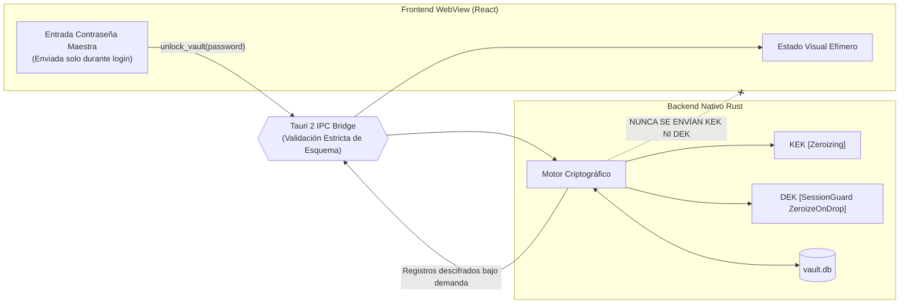

# MODELO DE SEGURIDAD IPC Y PROTECCIÓN DE MEMORIA 🛡️
> **NEXUS VAULT — Directrices de Comunicación React-Rust y Gestión de Secretos**

---

## 1. Principio de Aislamiento de Confianza

En la arquitectura de NEXUS VAULT existe una frontera de confianza (*Trust Boundary*) estricta entre dos entornos:

1. **Host Nativo Rust (Dominio de Alta Confianza)**:
   - Acceso al sistema de archivos local, SQLite, primitivas del sistema operativo.
   - Custodio exclusivo de las claves criptográficas **KEK** y **DEK**.
   - Ejecuta todo el cifrado, descifrado, derivación KDF y rotación.
   - Control de memoria determinista mediante `Zeroize` / `ZeroizeOnDrop`.

2. **Frontend WebView / React 18 (Dominio No Confiable / Presentación)**:
   - Se ejecuta en el contexto de WebView2 (Windows) o WebKitGTK (Linux).
   - Sujeto a las características de gestión de memoria del motor V8 / JavaScript.
   - **Regla Inquebrantable**: Las claves maestras, KEK y DEK **JAMÁS** cruzan el puente IPC hacia el frontend.



---

## 2. Límites Reales de la Protección de Memoria (Análisis Honesto)

### 2.1. Memoria en Rust (Control Determinado)
En el backend de Rust, el uso de las traits `Zeroize` y `ZeroizeOnDrop` permite garantizar que:
- Los búferes de la KEK y la DEK se sobreescriben con ceros al salir del alcance (*drop*).
- La estructura `MasterPassword` limpia su vector subyacente deterministamente.
- Las estructuras sensibles implementan `fmt::Debug` personalizado que redacta los campos como `"[REDACTED_SECRET]"`, evitando fugas en logs de depuración o pánicos.

### 2.2. Memoria en V8 / JavaScript (Limitación Inevitable)
En el frontend (React/V8):
- Las cadenas de texto (`string`) en JavaScript son **inmutables** y se asignan en el heap administrado por el recolector de basura (*Garbage Collector*).
- No existe ninguna API en el estándar de JavaScript que permita sobrescribir físicamente con ceros la memoria de una cadena ya asignada.
- Al concatenar o copiar una contraseña en JavaScript, V8 puede crear duplicados temporales en generaciones de memoria (*nursery*, *old-space*) que persisten hasta que el GC decide compactar la memoria.

> **Declaración de Seguridad Honesta**: NEXUS VAULT **no afirma** que `Zeroize` erradique todas las copias de secretos del espacio de direcciones del proceso completo. Cualquier contraseña visualizada en la interfaz gráfica genera cadenas en el heap de JavaScript que escapan al control de Rust.

### 2.3. Mitigaciones en Profundidad Adoptadas
Para minimizar la exposición ante esta limitación intrínseca de los WebViews:
1. **Descifrado Bajo Demanda**: No se envía toda la base de datos descifrada al frontend. Las contraseñas en texto plano solo se solicitan a Rust cuando el usuario abre el panel de detalle o pulsa el botón de ver contraseña.
2. **Purga Inmediata al Bloquear**: Al pulsar "Bloquear Bóveda" (`Ctrl+L`) o por inactividad:
   - El backend de Rust destruye la DEK y el `SessionGuard` con `zeroize()`.
   - El store de Zustand en React sobreescribe inmediatamente su estado:
     `items = []`, `selectedItem = null`, `editingItem = null`, `clipboardNotification = null`.
3. **Cero Persistencia No Cifrada**: Queda terminantemente prohibido utilizar `localStorage`, `sessionStorage`, `IndexedDB` o cookies para almacenar contraseñas, tokens de sesión o metadatos de la bóveda.

---

## 3. Endurecimiento de Tauri 2

### 3.1. Política de Seguridad de Contenido (CSP Estricta)
Para prevenir ataques de inyección de código (XSS) y ejecución remota de scripts, la configuración de Tauri 2 aplica:

```text
default-src 'self'; 
script-src 'self'; 
style-src 'self' 'unsafe-inline'; 
img-src 'self' data:; 
connect-src 'self'; 
font-src 'self'; 
object-src 'none'; 
base-uri 'self'; 
form-action 'none';
```

- **Prohibido**: Carga de scripts remotos (`https://*`), `unsafe-eval`, fuentes externas de red no auditadas.

### 3.2. Capacidades y Permisos Mínimos
En Tauri 2, el acceso al sistema se restringe mediante archivos de capacidad en `src-tauri/capabilities/`:
- **Permisos Otorgados**:
  - `core:default`: Ciclo de vida básico de ventanas y eventos de foco/minimización.
  - Comandos propios de la aplicación registrados explícitamente en el router IPC.
- **Permisos Denegados / Desactivados**:
  - `fs:allow-all`: Desactivado. La aplicación no puede leer ni escribir fuera del directorio de datos autorizado.
  - `shell:allow-execute`: Desactivado. Prohibida la ejecución de binarios o comandos del sistema desde el frontend.
  - `http:allow-all`: Desactivado. Cero llamadas HTTP no controladas.

### 3.3. Manejo Seguro de Enlaces Externos
Cuando el usuario pulsa en la URL de un registro:
- El frontend **nunca** invoca comandos de consola directa ni ejecuta `shell:open` de forma arbitraria.
- La URL se valida previamente asegurando que el esquema sea exclusivamente `http:` o `https:`.
- Esquemas peligrosos como `file:`, `javascript:`, `data:`, `vbscript:`, `ms-msdt:`, o rutas UNC (`\\attacker\share`) son estrictamente bloqueados antes de ser delegados al navegador predeterminado del sistema operativo.
